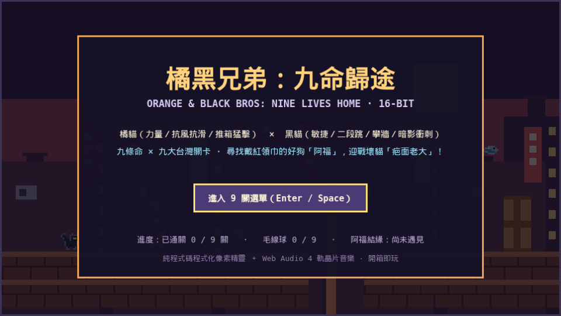
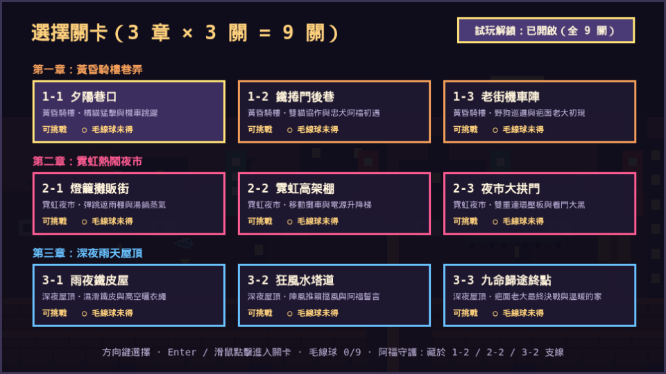
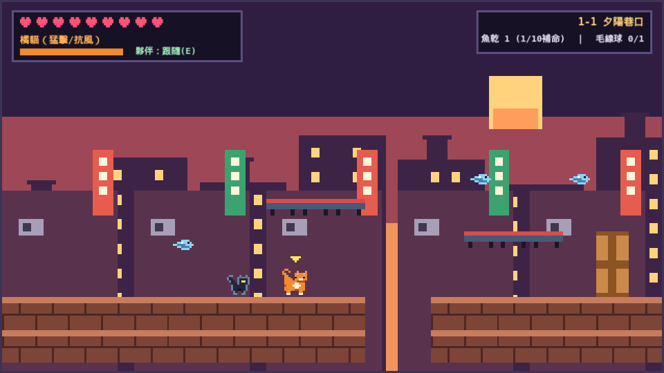
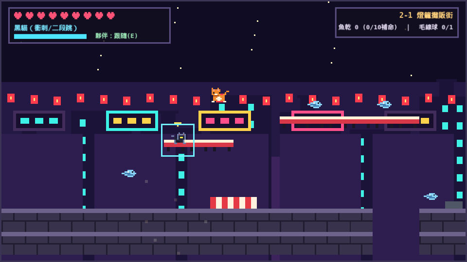
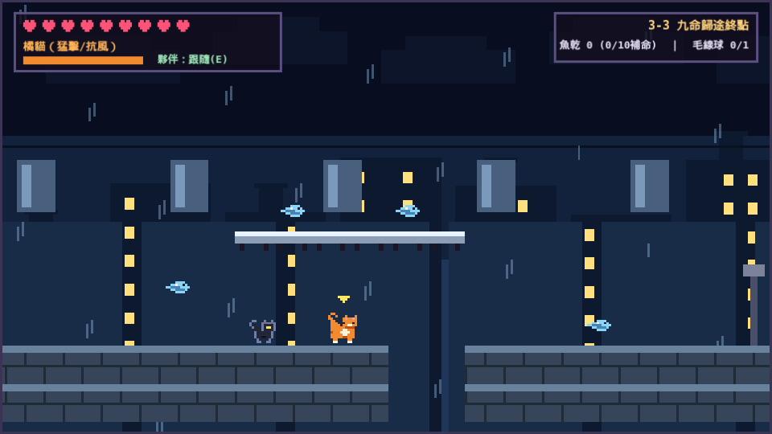

# 橘黑兄弟：九命歸途（Orange & Black Bros: Nine Lives Home）

> 一款 **16-bit 復古像素風格**的台灣街景橫向捲軸雙貓動作解謎遊戲。  
> 零外部圖片、零外部音檔，純 TypeScript + HTML5 Canvas 2D 程式化像素精靈烘焙 ＋ Web Audio API 4 軌晶片合成器，開箱即玩！

[](https://cats-bro.pages.dev/)
[](./LICENSE)
[](#技術架構與-sdd-規格)

### 🚀 開始遊戲
- **線上即開即玩**：**[https://cats-bro.pages.dev/](https://cats-bro.pages.dev/)**
- 支援桌機鍵盤雙手配置，選關畫面右上角提供「**試玩解鎖**」一鍵開關，可隨時直跳夜市或 3-3 屋頂 Boss 決戰！

---

## 📸 遊戲畫面截圖

| 標題畫面 | 9 關選關介面（3 章 × 3 關） |
| :---: | :---: |
|  |  |

| 第一章：黃昏騎樓巷弄（1-1 夕陽巷口） | 第二章：霓虹熱鬧夜市（2-1 燈籠攤販街） |
| :---: | :---: |
|  |  |

| 第三章：深夜雨天屋頂（3-3 九命歸途終點） |
| :---: |
|  |

---

## 🐱 核心特色

- **雙貓兄弟分工協作**：
  - **橘貓（力量型・大橘）**：防滑抗風、體重重（`weight = 2`）可壓住重壓踏板、推動木箱擋風墊腳、「**肉球猛擊**」撞碎脆紙箱並可破防 Boss。
  - **黑貓（敏捷型・小黑）**：跳躍高、二段跳、攀牆跳、「**暗影衝刺**」附無敵幀穿過野狗與 `12px` 鐵捲門窄縫。
  - 隨時一鍵即時切換主控貓，另一隻由 AI 支援 **跟隨 / 原地待命** 混合協作。
- **貓有九條命 × 台灣九關歸途**：共用 **9 條命**，每累計收集 **10 條小魚乾**自動補 1 命（上限 9 命）；全 9 關各藏 1 顆毛線球（合計 9 顆）。
- **純程式碼 16-bit 視聽**：
  - 雙層畫布混合渲染（`320×180` 銳利像素世界 ＋ `960×540` 清晰正體中文 UI 覆蓋層）與 3 層視差台灣街景。
  - **Web Audio API 4 軌晶片合成器**：6 首原創復古樂曲（標題、黃昏騎樓、霓虹夜市、深夜雨屋頂、Boss 決戰、回家結局）與 19 種復古 SFX。

---

## 🗺️ 遊戲關卡與反轉劇情劇透

<details>
<summary><b>點擊展開：完整 9 關列表、隱藏英雄「忠犬阿福」與反轉 Boss「疤面老大」劇透</b></summary>

### 隱藏反轉角色
- **隱藏英雄（Hero）— 忠犬「阿福」**：打破「野狗都是敵人」的印象！戴著鮮明**紅領巾**的溫順米克斯好狗藏身於 **`1-2`、`2-2`、`3-2`** 的支線暗巷／避雨棚（靠近時會飄出「汪…♪」音符與紅領巾閃光線索）。與阿福結緣後，在**任一關卡瀕死（最後 1 命歸零瞬間）**，阿福都會高速衝鋒救援——攔截致死、撞飛野狗（或在 3-3 直接撞暈 Boss）、立即拉回 **3 條命** 並賦予 **2.5 秒金色無敵護盾**（每關限 1 次）！
- **反轉 Boss — 惡霸壞貓「疤面老大」**：打破「同族一定友善」的預期！左眼帶紫紅刀疤的灰虎斑惡霸貓會在 **`1-3`** 與 **`2-3`** 尾聲現身挑釁，並於 **`3-3` 雨夜屋頂終點前**展開 3 階段正式 Boss 決戰：
  1. **第一階段**：黑貓暗影衝刺閃避紅線衝爪，引誘牠撞上水塔牆壁暈眩 → 橘貓「肉球猛擊」破防！
  2. **第二階段**：橘貓抗風／推箱擋下魚罐頭彈幕，黑貓攀牆拉下高處**水塔水閥**將牠沖落暈眩 → 橘貓猛擊破防！
  3. **第三階段（狂暴）**：閃避二連衝爪與雨夜落雷完成最後一擊，擊敗後開啟散發暖黃燈光的家門！

### 3 大章節 × 3 小關 = 9 關總表
| 章節 | 關卡 ID | 關卡名稱 | 場景亮點與機關 | 隱藏要素 |
| :---: | :---: | :--- | :--- | :--- |
| 第一章<br>黃昏騎樓 | `1-1` | 夕陽巷口 | 機車單向平台、脆紙箱堆、小魚乾教學 | 毛線球 #1 |
| 第一章<br>黃昏騎樓 | `1-2` | 鐵捲門後巷 | 重壓踏板＋12px 窄縫鐵捲門、推箱、巡邏野狗 | 毛線球 #2 ＋ 🐕 **阿福初遇** |
| 第一章<br>黃昏騎樓 | `1-3` | 老街機車陣 | 密集機車、淺水窪、巡邏野狗、推箱協作 | 毛線球 #3 ＋ 😈 **疤面老大初現** |
| 第二章<br>霓虹夜市 | `2-1` | 燈籠攤販街 | 紅白彈跳遮雨棚、間歇噴發湯鍋蒸氣 | 毛線球 #4 |
| 第二章<br>霓虹夜市 | `2-2` | 霓虹高架棚 | 移動攤車、高處電源開關＋電動升降梯 | 毛線球 #5 ＋ 🐕 **阿福支線** |
| 第二章<br>霓虹夜市 | `2-3` | 夜市大拱門 | 雙重連環壓板鐵閘、看門狗大黑 | 毛線球 #6 ＋ 😈 **疤面老大挑釁** |
| 第三章<br>深夜雨屋頂 | `3-1` | 雨夜鐵皮屋 | 濕滑鐵皮屋頂（橘貓抗滑）、高空曬衣繩 | 毛線球 #7 |
| 第三章<br>深夜雨屋頂 | `3-2` | 狂風水塔道 | 間歇強陣風＋擋風推箱、積水落雷 | 毛線球 #8 ＋ 🐕 **阿福誓言** |
| 第三章<br>深夜雨屋頂 | `3-3` | 九命歸途終點 | 暴雨衝刺 → **疤面老大 3 階段屋頂決戰** → 溫暖家門 | 毛線球 #9 ＋ **普通／九命圓滿真結局** |

> **真結局條件**：集滿全 9 關共 **9 顆毛線球**，且曾與**忠犬阿福**結緣並通關 `3-3`，即可解鎖「九命圓滿・歸途傳奇」真結局！

</details>

---

## ⌨️ 操作方式

| 功能 | 主要按鍵 | 備用按鍵 |
| :--- | :--- | :--- |
| 左右移動 | `A` / `D` | `←` / `→` |
| 跳躍（黑貓支援二段跳／攀牆跳） | `Space` | `W` / `↑` / `Z` |
| 專屬技能（橘貓猛擊／黑貓暗影衝刺） | `J` | `X` / `Shift` |
| 即時切換主控貓（橘貓 ⇄ 黑貓） | `Q` | `Tab` / `C` |
| 切換夥伴模式（跟隨 ⇄ 待命） | `E` | `K` |
| 暫停／靜音 | `P` / `Esc` | `M` |

---

## 🏗️ 技術架構與 SDD 規格

本專案採用 **SDD（Spec-Driven Development）規格與契約先行**，並經 **PSTACK 雙輪獨立架構審查（Round 1 REJECT → v2.1 修訂 → Round 2 APPROVE）** 後才進入實作，模擬層與渲染層嚴格解耦：

- [系統設計規格書（docs/SDD.md）](./docs/SDD.md)
- [介面與資料契約（docs/CONTRACTS.md）](./docs/CONTRACTS.md)
- [契約驗收測試（tests/contracts.test.ts）](./tests/contracts.test.ts)（`C-01` ~ `C-09` 全數通過）

### 本機開發與測試
```bash
npm install
npm run dev        # 啟動本機開發伺服器 (http://localhost:5173)
npm run typecheck  # TypeScript 嚴格型別檢查
npm test           # 執行 Vitest 契約驗收測試 (C-01 ~ C-09)
npm run build      # 建置 dist/ 靜態檔案
```

---

## 🤝 共同發表人與開發模型（Credits & Co-Authors）

- **共同發表人（Co-Authors）**：
  - **老湯（[@tonnychiulab](https://github.com/tonnychiulab)）** — 遊戲總監、創意發想、反轉劇情與九命九關設計、實機驗收
  - **Antigravity（Google DeepMind）** — 系統架構設計、SDD 規格與契約工程、程式化像素美術、Web Audio 晶片合成器與全端實作
- **使用模型**：**Gemini 4 Neon (Medium)**
- **工程品質輔助**：Spec-Driven Development（SDD）＋ Cursor `pstack` 雙輪契約審查 ＋ Vitest 契約測試矩陣

## 📄 License
MIT
