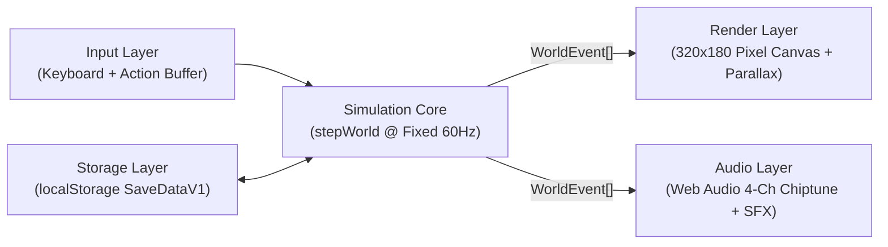
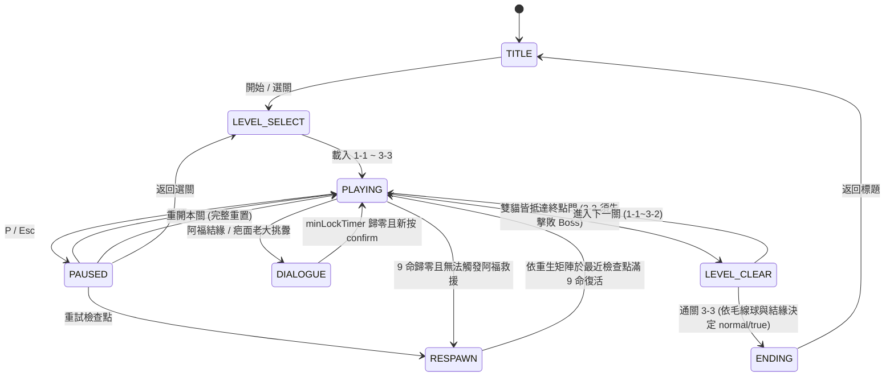

# 《橘黑兄弟：九命歸途》（Orange & Black Bros: Nine Lives Home）系統設計規格書（SDD）

- **版本**：v2.1（已整合 PSTACK Round 1/2 審查修訂 ＋ 第二次 `/grill-me` 體驗複查）
- **專案代號**：`cats-bro`
- **技術棧**：Vite + TypeScript + HTML5 Canvas 2D + Web Audio API（零外部圖片／音檔依賴）
- **核心設計哲學**：**Spec-Driven Development（契約先行）**、**模擬層與渲染層嚴格解耦**、**讓非法狀態無法於型別系統中表示**、**固定 60Hz 決定性模擬**。

---

## 1. 系統架構與模組邊界

遊戲分為四個單向依賴層，核心模擬層完全不依賴 DOM、Canvas 或 Web Audio，可於 Vitest 中 100% 決定性測試。

### 1.1 層級職責與單一真相來源（Single Source of Truth）
1. **核心模擬層（`src/core/`, `src/entities/`, `src/levels/`）**：
   - 唯一真實狀態為 `WorldState`；所有模擬內部幾何座標與時間一律採用品牌化像素 `Px` 與秒 `Seconds`。
   - `parseLevel(raw: LevelRawSpec): LevelData` 位於資料邊界，負責將 ASCII 關卡地圖與格座標（`TileIndex`）一次轉譯為強型別 `Px` 座標並驗證所有靜態不變量（`INV-LVL`）。
   - 模擬推進函式 `stepWorld(world, input, dt): WorldEvent[]` 以固定 `FIXED_DT = 1 / 60` 秒執行，不直接操作 Canvas 或 AudioContext，統一回傳 `WorldEvent[]` 給渲染與音訊層消費。
2. **渲染層（`src/art/`, `src/ui/`）**：
   - **雙層畫布混合架構**：底層 `320×180` 銳利 16-bit 像素世界畫布（`image-rendering: pixelated`），上層疊加 `960×540`（3× 整數倍）高解析像素框線 UI 覆蓋層，專門繪製繁體中文對話框、標題／選關選單與清晰 HUD，兼顧復古像素感與中文易讀性。
   - **高對比視覺引導**：黑貓採用深藍灰毛色＋1px 微亮輪廓高光與亮金雙眼（確保深夜屋頂不隱形）；主控貓頭頂浮動小黃箭頭（`▼`）、待命貓頭頂顯示鎖定腳印圖示、切貓觸發圓形波紋與平滑鏡頭追蹤；畫布下方附極簡可隱藏操作提示列。
   - **對話框單一真相**：UI 層僅讀取 `world.scene.kind === 'DIALOGUE'` 顯示對話框，避免重複彈窗。
3. **音訊層（`src/audio/`）**：於使用者首次互動手勢後解鎖 `AudioContext`，依 `WorldEvent` 驅動 4 軌晶片音序器與 SFX。
4. **存檔層（`src/core/storage.ts`）**：負責 `SaveDataV1` 之白名單驗證與損毀回退；選關畫面提供低調的「全部解鎖（試玩模式）」開關，可直跳任一關（含 2-1 夜市、3-3 Boss 戰）而不覆寫真實通關與毛線球紀錄。

---

## 2. 全域遊戲狀態機

### 2.1 對話與輸入防誤觸規則
- 進入 `DIALOGUE` 狀態時，強制設定 `minLockTimer = 0.25s`，期間忽略 `confirm`。
- 關閉 `DIALOGUE` 時必須為**新一次 `justPressed.confirm`**，且切回 `PLAYING` 當幀強制將 `input.jumpBufferTimer = 0`，避免 `Space` 鍵同時關閉對話與誤跳墜坑。

---

## 3. 核心子系統規格

### 3.1 物理、碰撞與 Tile 語意表
- **固定步進**：單幀累加時間上限 `0.05s`，以 `FIXED_DT = 1 / 60` 分步執行；分軸 AABB 解算（先 X 後 Y）。
- **手感輔助**：Coyote Time `0.10s`、Jump Buffer `0.10s`。
- **基礎加減速度**：
  - 一般地面水平加速度 `720 px/s²`、減速度 `900 px/s²`。
  - **濕滑鐵皮（TileType 3）**：黑貓減速度降至 `120 px/s²`（產生滑行慣性）；**橘貓防滑**維持 `900 px/s²`。
  - **淺水窪（TileType 4）**：黑貓移動速度倍率降至 `0.65`（觸發水花微粒）；橘貓維持 `0.90`。
- **間歇強陣風（3-2 / 3-3）**：週期 `5.0s`（`0.0~2.0s` 平靜、`2.0~2.5s` 風線預警、`2.5~5.0s` 吹襲）。`windActive`／`windWarning` 單點由 `windTimer` 推算，並以 `levelWind || bossWind` 區分 Boss Phase 2 小陣風。吹襲期間對未受 `pushBox(blocksWind)` 遮蔽的黑貓施加 `-165 px/s²` 水平加速度；**橘貓抗風**完全免疫。
- **移動平台載客**：`movingPlatform` 每幀計算位移 `(dx, dy)`，同步帶動站於其上表面的雙貓與推箱。

| TileType | ASCII 符號 | 名稱 | 碰撞屬性 | 特殊行為 |
| :---: | :---: | :--- | :--- | :--- |
| `0` | `.` | 空氣 | 可穿透 | 無 |
| `1` | `#` | 實心磚塊 | 四向實心 | 阻擋移動；不可攀牆 |
| `2` | `=` | 單向平台 | 僅上表面阻擋（`vy >= 0` 且腳底高於平台上緣） | 機車坐墊、遮雨棚架、曬衣繩 |
| `3` | `~` | 濕滑鐵皮 | 四向實心 | 上表面對黑貓套用濕滑減速度 `120 px/s²` |
| `4` | `w` | 淺水窪 | 可穿透（置於實心磚上方一格） | 進入時標記 `inPuddle = true`，套用水窪減速 |
| `5` | `|` | 可攀爬牆面 | 四向實心 | 黑貓貼牆下落時進入 `wallSlide`（落速上限 `48 px/s`）並可攀牆跳 |

### 3.2 雙貓角色能力與碰撞尺寸（算術驗證閉環）
- **碰撞尺寸與窄縫餘量**：
  - 橘貓：`w = 14px, h = 14px`
  - 黑貓：`w = 11px, h = 11px`
  - 鐵捲門底部窄縫：`bottomGapPx = 12px` → 黑貓（`11 < 12`）可流暢鑽過；橘貓（`14 > 12`）嚴格被物理阻擋，零邊界模糊。
- **橘貓（`orange`・力量型）**：
  - 移速 `78 px/s`、跳速 `-210 px/s`、重力 `680 px/s²`、重量 `2`、防滑抗風。
  - **肉球猛擊（`smash`）**：耗體力 `40/100`（`0.6s` 後以 `45/s` 回復），持續 `0.18s`，內建 `hitTargetIds: Set<EntityId>` 確保單次猛擊對同一脆紙箱或 Boss **至多命中一次**。可撞碎脆紙箱、推動木箱、對暈眩中的疤面老大造成 `1` 點破防傷害（Boss `maxHp = 3`）。
- **黑貓（`black`・敏捷型）**：
  - 移速 `102 px/s`、跳速 `-235 px/s`、二段跳 `-205 px/s`、重力 `610 px/s²`、重量 `1`、支援攀牆跳。
  - **暗影衝刺（`shadowDash`）**：耗體力 `45/100`（`0.5s` 後以 `55/s` 回復），持續 `0.16s`，高速移動 `42px`；期間狀態型別保證 `vy === 0` 且完全免疫接觸傷害，可穿過野狗、Boss 衝爪與鐵捲門窄縫。

### 3.3 AI 夥伴混合模式與防跳關規則
1. **距離取樣 Breadcrumb**：主控貓每移動超過 `8px` 或起跳時寫入 1 筆路標（容量 48 點），確保速度較慢的橘貓不會吃到過期幀。
2. **自動隔離保護（杜絕瞬移破關）**：
   - 當主控黑貓穿過未開啟之 `gate`（`bottomGapPx > 0`）導致雙貓分居門兩側時，系統自動將橘貓切為 `STAY`（頭頂浮現等待圖示）。
   - 安全瞬移僅在 `FOLLOW` 模式、距離 `> 180px`（或卡住 `2.5s` 且距離 `> 48px`）、**且雙貓之間不存在關閉中之 `gate` 阻隔**時才允許執行；落腳點必須驗證為「自身不與實心磚重疊且腳下為實心/單向平台」。
3. **非主控夥伴保護**：
   - 非主控夥伴貓**免疫敵人、蒸氣、落雷與 Boss 接觸傷害**（避免 AI 失誤害玩家扣命）；若夥伴貓意外掉入深坑，直接無傷瞬移回主控貓 `lastSafePos`。
   - 玩家按 `Q` 切換主控貓時，賦予 `switchGraceTimer = 0.25s` 換手無敵幀，防止切換瞬間暴斃。

### 3.4 九命系統、三層無敵計時與重生矩陣
- **生命上限**：`MAX_LIVES = 9`（呼應「貓有九條命」）。每關開始與檢查點重生皆補滿 `9` 命。
- **獨立無敵計時器（互不覆蓋）**：
  - `hurtInvulnTimer`（`1.2s`）：主控貓受接觸傷害後啟動。
  - `heroShieldTimer`（`2.5s`）：忠犬阿福救援後啟動。
  - `switchGraceTimer`（`0.25s`）：切換主控貓時啟動。
  - 接觸傷害判定：任一計時器 `> 0` 或黑貓處於 `shadowDash` 即免疫；**深坑墜落**一律扣 `1` 命並傳回 `lastSafePos`（但若此傷害使 `lives <= 0` 仍會觸發阿福攔截致死）。
- **小魚乾補命**：每累計拾取 `10` 條不重複小魚乾：若 `lives < 9` 則 `lives += 1`，否則 `score += 200`。
- **木箱防軟鎖**：若 `pushBox` 掉入深坑，立即於其初始座標重生。
- **毛線球入檔時機**：拾取毛線球時先記錄於 `world.yarnCollectedInLevel = true`，於**正式通關（`LEVEL_CLEAR`）**時才寫入 `SaveDataV1.collectedYarns`（避免進關吃球即退刷成就）。

#### 檢查點重生（`RESPAWN`）狀態重置矩陣

| 狀態項目 | `RESPAWN`（9 命歸零／重試檢查點） | 重開本關（暫停選單） |
| :--- | :--- | :--- |
| 命數（`lives`） | 重置為 `9` | 重置為 `9` |
| 雙貓位置 | 檢查點（若未達檢查點則為起點） | 關卡起點 |
| 推箱／脆紙箱／未鎖定開關／水閥 | **重置回初始狀態**（防推箱軟鎖） | **重置** |
| Boss HP 與狀態（3-3） | **重置為 `dormant`（HP = 3）** | **重置** |
| 已拾取小魚乾（`collectedFishIds`） | **保留**（防無限刷魚洗分） | **重置** |
| 本關已拾取毛線球 | **保留** | **重置** |
| 本關阿福救援已使用（`heroRescueUsedInLevel`） | **保留**（每關嚴格限 1 次） | **重置** |

### 3.5 反轉角色規格
1. **隱藏英雄：忠犬「阿福」（Hero Dog）**
   - 出現於 `1-2`、`2-2`、`3-2` 的輕度支線暗巷／避雨棚（戴紅領巾土黃米克斯犬）；主控貓靠近附近時，畫面邊緣飄出微弱的「汪…♪」音符與紅領巾閃光提示，方便留心探索的玩家發現。靠近互動後設定 `world.heroBonded = true` 並立即寫入 `SaveDataV1.heroBonded = true`。
   - **全 9 關統一救援規則（方案 A・零特例）**：
     - 唯一觸發條件：`world.heroBonded === true && !world.heroRescueUsedInLevel && (lives - 1) <= 0`。
     - 觸發效果：攔截死亡 → `heroRescueUsedInLevel = true`、`lives = 3`、`heroShieldTimer = 2.5s`、`hitStopTimer = 0.25s`，觸發阿福衝鋒演出，擊飛畫面內野狗；若在 3-3 Boss 戰且 Boss 為 `active`，強制令 Boss 進入 `STUNNED (2.5s)`。
2. **反轉 Boss：壞貓「疤面老大」（Boss Bad Cat）**
   - `1-3`、`2-3` 終點前以 `DIALOGUE` 挑釁演出登場。
   - **3-3 屋頂競技場正式開戰**：
     - 任一貓踏入 `arenaBounds` 時，**強制將另一隻貓一同傳送至競技場入口安全點**並封閉入口，徹底杜絕門外軟鎖。
     - `maxHp = 3`（每記橘貓破防猛擊扣 `1` HP，受擊後立即進入 `HURT (0.8s)` 無敵狀態，杜絕多幀秒殺）：
       - **Phase 1（HP = 3）**：紅線預警衝爪 → 黑貓閃避誘其撞上兩側水塔牆壁進入 `STUNNED (2.2s)` → 橘貓猛擊破防（HP → 2）。
       - **Phase 2（HP = 2）**：跳上高台投擲 3 枚魚罐頭彈幕＋啟動小陣風 → 橘貓抗風穩站／推箱擋彈幕，黑貓攀牆拉下高處 `waterValve` 水閥沖落 Boss 進入 `STUNNED (2.5s)` → 橘貓猛擊破防（HP → 1）。
       - **Phase 3（HP = 1，狂暴）**：二連衝爪＋雨夜落雷鎖定（`CALL_LIGHTNING`）→ 撞牆／水閥（或阿福救援）使其暈眩後，橘貓最後一擊擊敗 Boss（`DEFEATED`），開啟溫暖家門。

---

## 4. 九關章節結構（3 × 3）與正交機關設計

全 9 關皆以 **ASCII 視覺地圖** 定義於 `src/levels/chapter1~3.ts`，由 `parseLevel()` 邊界轉譯並驗證。所有機關統一收斂為 8 種正交原語：`crate`、`pushBox`、`trigger`、`gate`、`movingPlatform`、`spring`、`hazard`、`waterValve`。

| 關卡 ID | 名稱 | 章節主題 | 核心機關／障礙 | 隱藏與劇情要素 |
| :--- | :--- | :--- | :--- | :--- |
| `1-1` | 夕陽巷口 | 黃昏騎樓巷弄 | 機車單向平台、脆紙箱、小魚乾 | 毛線球 #1 |
| `1-2` | 鐵捲門後巷 | 黃昏騎樓巷弄 | 重壓踏板＋12px 窄縫鐵捲門、推箱、巡邏野狗 | 毛線球 #2＋**阿福結緣點** |
| `1-3` | 老街機車陣 | 黃昏騎樓巷弄 | 密集機車、淺水窪、巡邏野狗、推箱協作 | 毛線球 #3＋**疤面老大挑釁** |
| `2-1` | 燈籠攤販街 | 霓虹熱鬧夜市 | 彈跳遮雨棚（`spring`）、間歇湯鍋蒸氣（`hazard:steam`） | 毛線球 #4 |
| `2-2` | 霓虹高架棚 | 霓虹熱鬧夜市 | 移動攤車、高處電源開關＋升降梯（`movingPlatform`） | 毛線球 #5＋**阿福結緣點** |
| `2-3` | 夜市大拱門 | 霓虹熱鬧夜市 | 雙重連環壓板（`gate` 多 `requiredTriggerIds`）、看門狗大黑 | 毛線球 #6＋**疤面老大挑釁** |
| `3-1` | 雨夜鐵皮屋 | 深夜雨天屋頂 | 濕滑鐵皮（`TileType 3`）、曬衣繩單向平台 | 毛線球 #7 |
| `3-2` | 狂風水塔道 | 深夜雨天屋頂 | 間歇強陣風＋擋風推箱、積水落雷（`hazard:lightning`） | 毛線球 #8＋**阿福結緣點** |
| `3-3` | 萬里歸途終點 | 深夜雨天屋頂 | 暴雨短衝刺 → **疤面老大 3 階段 Boss 戰** → 溫暖家門 | 毛線球 #9＋普通／真結局 |

- **真結局條件**：通關 `3-3` 且 `collectedYarns.length === 9 && heroBonded === true` → `ENDING(true)`（九命圓滿・阿福同慶）；否則進入 `ENDING(normal)`。
